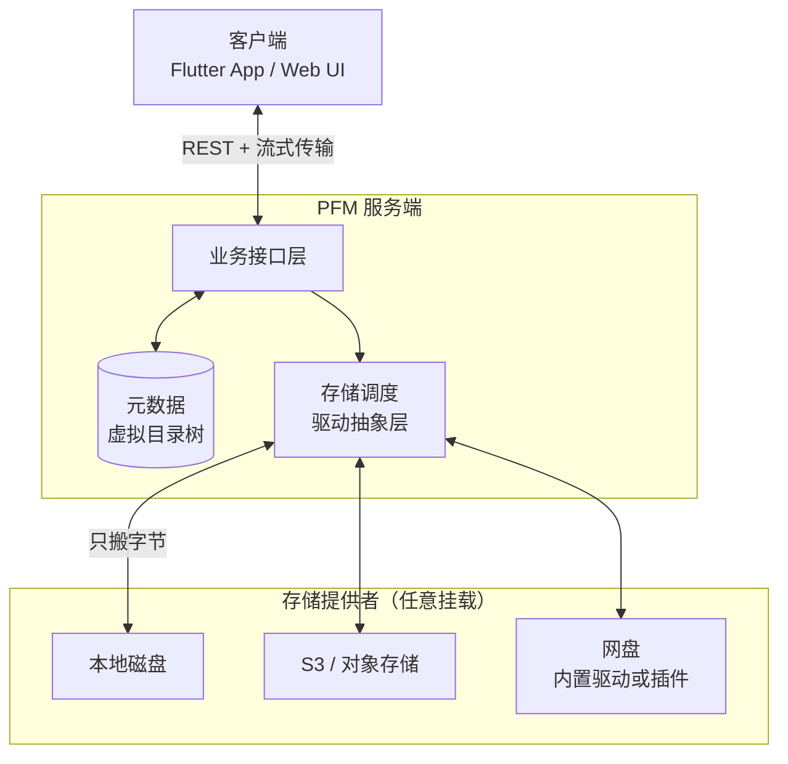

# PFM

PFM(Personal File Manager)是一款个人文件管理系统。前端使用 Flutter 开发，后端使用 go 开发。

## 概念介绍
在介绍系统特性前，先介绍一个特别重要的概念：存储提供者。
它是实际存放文件的地方，可以是本地硬盘，可以是S3存储桶，也可以是网盘，可以是一切可以存储文件的东西。
后续介绍会涉及到它，所以先说一下，避免大家不理解。

## 特性
- 虚拟目录与文件元数据独立管理（文件树与文件内容分离），不依赖存储提供者的目录
- 多存储提供者挂载支持
- 存储提供者驱动插件化开发
- 文件夹级别的存储绑定策略：管理员分配可用存储提供者，用户在分配范围内为目录选择落盘目标。比如，系统挂载了10个存储提供者，管理员分配了三个给指定用户，此用户在创建文件夹的时候可以选择绑定其中任意一个或多个。
- 上传的文件会根据文件夹绑定的存储提供者自动分发
- 存储提供者实例之间文件同步
- 基于 BLAKE3 的内容去重与秒传，
- 文件夹级别的加密功能
- 可控分享
- 桌面端 / 移动端统一 Flutter 客户端
- 在不涉及实际的文件内容时，请求不会直接打到存储提供者的官方服务器。比如，移动、复制、重命名、列表等操作，在本地的服务器就可以直接完成，能有效降低存储提供者官方 API 的调用频率（例如阿里云盘 openapi 对获取列表接口有明确限频），因为列表与元数据由本地系统维护。
- 方便的相册，视频自动备份功能
- WebDAV
- 离线下载
- 用户之间目录隔离，可以通过分享功能共享数据
- 历史版本

## 当前实现概览

- **后端**：Go 1.26+；`net/http` + REST/JSON（proto 只定义数据结构）；GORM + SQLite / PostgreSQL / MySQL；本地账号 + HS256 JWT；驱动以元数据描述自身配置，前端表单据此自动渲染；支持进程外插件（存储驱动 / 离线下载后端），核心只内置 `local` 驱动、不内置下载器。
- **客户端**：Flutter（Dart SDK `^3.13.0`），`flutter_bloc` + `go_router` + `Dio`，Hive / SQLite 本地持久化，与后端共用 protobuf 数据结构；另带一套无需构建的 Web UI，已 `//go:embed` 进二进制。
- **内置驱动**：`local`。
- **主要能力**：文件树 / 回收站 / 标签 / 历史版本、分片上传与断点续传、BLAKE3 秒传、多提供者副本同步、直链下载（不可直链时自动回退代理）、可控分享、WebDAV、URL 离线下载、缩略图与流式预览、移动端相册与通讯录 / 短信 / 通话记录备份。

## 核心设计要点

核心是**逻辑文件与物理副本分离**：虚拟目录、文件名、标签、历史版本等元数据由本地系统维护，真实字节则存放在某个存储提供者的某个位置。

- 列表、移动、复制、重命名、回收站这类操作只改元数据，不会请求存储提供者，因此不受其官方接口限频影响。
- 一条文件记录可以对应多个提供者上的多份副本；一次上传后其余副本按需同步，不必重复上传。
- 落盘目标由目录绑定解析得出：管理员分配可用提供者作为上限，用户在创建目录时从中选择，子目录继承父目录，最终取交集。
- 内容以 BLAKE3 去重，hash 命中即秒传。
- 用户之间按归属隔离；管理员特权只作用于管理功能，不能操作他人文件。

## 架构



- 客户端只跟服务端打交道，看到的目录树来自本地元数据，与存储提供者内部的目录结构无关。
- 存储提供者只是「放字节的地方」，挂本地盘、S3 桶还是网盘，对上层是同一套接口。
- 移动 / 重命名 / 复制 / 列表只改元数据；只有上传与读取字节时才经过驱动。
- 因此换提供者、加副本、一份内容多副本共存，都不影响虚拟目录与元数据。

## 仓库结构

```text
.
├── api/                # REST 业务处理器
├── server/             # HTTP 服务、路由表、中间件、WebDAV、内置 Web UI
├── internal/
│   ├── service/        # 业务编排
│   ├── db/             # 数据访问层
│   ├── storage/        # 上传调度、提供者解析、副本维护
│   └── ...             # auth / config / download / thumbnail / backup
├── driver/             # 内置存储驱动（只有 local）；orm/ 为宿主侧实体转换
├── cmd/                # cobra 子命令：server / user / plugin / cleanup-* 等
├── pkg/                # 通用库
├── config.example.yaml # 配置示例
└── dev.sh              # 构建 / 运行 / 测试统一入口（代码生成在契约仓库）
```

## 如何开发

### 开发环境

| 组件 | 要求 | 用途 |
|------|------|------|
| Go | 1.26+ | 后端编译与测试 |
| pfm-plugin-sdk | 见下方说明 | 插件 ABI 与驱动值类型，宿主与插件共用的唯一契约 |
| pfm-proto | 见下方说明 | 应用侧 protobuf：Go 数据结构 + GORM 实体 + Dart 包（都已入库，build 即可用） |
| Node.js | 能跑 `node --test` 即可 | Web UI 测试（可选） |
| golangci-lint | 任意较新版本 | 代码检查（可选） |
| Flutter / Dart | Flutter 3.47+（Dart `^3.13.0`） | 只有客户端仓库 `pfm-frontend` 需要 |
| Rust + Android NDK | 可选 | 客户端 BLAKE3 原生加速（在 `pfm-frontend` 里构建） |
| PostgreSQL / MySQL | 可选 | 默认 SQLite 是纯 Go 实现，无需额外安装 |

宿主**不生成任何代码**：`.proto`、Go 结构、GORM 实体、Dart 包都在 `pfm-proto` 仓库生成并入库。
所以 `go build` 只需要 Go 本身——不需要 buf / protoc 系列工具；要改 proto 才需要那些，
而且是在 `pfm-proto` 里用它的 `./dev.sh proto`。

### 上手

契约与客户端都在独立仓库里，宿主按 tag 依赖它们（`go.mod` 的 `require`，`go build` 自动取，
**不需要**先把仓库 clone 到旁边）：

| 仓库 | 内容 |
|---|---|
| `pfm-plugin-sdk` | 插件 ABI、驱动值类型、插件运行时 |
| `pfm-proto` | 应用侧 protobuf（Go 数据结构 + GORM 实体 + Dart 包 `pfm_proto`） |
| `pfm-frontend` | Flutter 客户端（只有做客户端时才需要） |

要同时改这两个契约仓库时，用工作区把目录并起来（`go.work` 不入库）：

```bash
go work init . ../pfm-plugin-sdk ../pfm-proto
```

```bash
git clone <repo> && cd pfm
cp config.example.yaml data/config.yaml # 按需改 db / server_url / sign_token
bash dev.sh build                       # 编译为 ./pfm
./pfm -d ./data user add <用户名>        # 本地认证没有注册入口，用户需手动创建
./pfm server -d ./data                  # 启动服务；health 检查 /health
```

不想自己编译的话，[Releases](https://github.com/jenken827/pfm/releases) 里有现成的二进制：

| 平台 | 文件 |
|---|---|
| Linux x86_64 | `pfm_<版本>_<日期>-<commit>_linux-amd64.tar.gz` |
| Windows x64 | `pfm_<版本>_<日期>-<commit>_windows-amd64.zip` |

解压出来是同名的 `pfm`（Windows 上是 `pfm.exe`）、`config.example.yaml` 和 `LICENSE`，
`./pfm version` 查版本；`checksums.txt` 是各包的 SHA-256。要自己打包就用
`bash scripts/package.sh --version <版本> --goos linux|windows`。

客户端在独立仓库 `pfm-frontend`（Flutter），用它的 `dev.sh`：

```bash
cd ../pfm-frontend
bash dev.sh get                     # 拉依赖（puro flutter pub get）
bash dev.sh build_runner            # 路由 / 序列化代码生成
bash dev.sh run windows             # 运行（设备名可省略，如 android / chrome）
bash dev.sh build android           # 构建 APK，产物另存 release/
```

登录页填服务端地址，用上面创建的账号登录。后端这边常用任务（`build` / `run` / `test` /
`test-web` / `lint` / `clean` / `proto` 等）都由 `bash dev.sh` 分发，`bash dev.sh help` 可看全部。

构建产物是单个自包含的 Go 二进制，怎么常驻（systemd、容器、进程管理器…）由部署方决定；配置文件默认读 `<DataDir>/config.yaml`，也可用 `-c` 指定。改了 `server/webui/` 需要重新 `bash dev.sh build` 才会生效。

## 如何开发驱动

驱动只负责「字节怎么进、怎么出」，目录树、移动、重命名、回收站、秒传判定、副本调度、权限与加密编排全在核心完成。所以对接一个网盘通常只用到它官方 API 的少数几类接口：上传、下载（或取直链），需要按目录寻址时再加一个列目录。

1. **声明元数据**：填 `native.DriverInfo`（身份 `driver_id`、显示名、图标、配置表单字段、能力列表）。前端「新增存储源」的表单据此自动渲染，不需要改前端。
2. **实现必选接口** `types.StorageDriver`：`GetType` / `GetName` / `GetConfig` / `GetProviderConfig`，加上两个内容面能力——
   - `Upload`：把明文源文件写到提供者，返回 `[]FileRef`（大文件由驱动自己决定怎么分片）；
   - `Open`：按 `FileRef` 打开字节流，支持按 offset 裁剪以便断点续传与 Range 播放。
   落到提供者的哪个物理目录也由驱动决定：`types.AllocateUploadDir` 配合 `DirBackend` 提供「年 / 月 / 数字子目录」分片，按 ID 寻址的提供者直接用自己的 ID 即可。
3. **按需实现可选能力**（实现即生效，不实现也不影响基本可用）：

   | 能力 | 接口 | 作用 |
   |------|------|------|
   | 直链 | `types.DirectLinker` | 客户端直连提供者取字节，省服务端带宽；不满足条件时核心自动回退代理下载 |
   | 远端枚举 | `types.RemoteLister` | `cleanup-storage-orphans` 逆向清理存储侧孤儿文件 |
   | 批量删除 | `types.BatchDeleter` | 删除 / 清空回收站时批量清理远端对象 |
   | 配置回写 | `types.ConfigPersisterSetter` | token 续期后写回提供者配置 |

4. **注册**：在 `init()` 里 `types.RegisterStorageDriverWithMetadata(ctor, metadata)`，内置驱动在 `driver/driver.go` 里 import 一行即生效。
5. **要独立分发就打成驱动插件**：加一个 `plugin.json`（`kind: "driver"` + `driver_id` + `exec` + `abi_version`），`main` 里 `func main() { sdk.MustServe("<driver_id>") }`；宿主打开 `plugin.enabled` 后通过 loopback RPC 调用同一个驱动。插件与宿主同权限运行，只应安装可信来源的二进制。装 / 删 / 回滚插件不用重启服务：`pfm plugin install` 会向运行中的实例发 `SIGHUP` 重新扫描插件目录并重建受影响的 provider（手工等价 `pfm plugin reload` 或 `kill -HUP <pid>`）。

边界：驱动包只能依赖插件 SDK（`github.com/jenken827/pfm-plugin-sdk` 的 `driver/types`、
`driver/cryptostream`、`pkg/crypt`、`plugin/sdk`、`proto/gen/abi`、`proto/gen/plugin`）和公共库，
**不要 import 宿主模块的任何包**（`internal/*`、宿主的日志与配置包），也**不要** import
`github.com/jenken827/pfm-proto`——那是后端与前端的应用侧契约，插件只要 SDK 的 ABI 类型。插件是独立进程、独立发布物，一旦依赖宿主内部实现，两个仓库就重新绑死了。

## 其他类型的插件

`plugin.json` 里的 `kind` 决定宿主怎么用它，目前有两种：

| kind | 身份字段 | 作用 |
|------|----------|------|
| `driver` | `driver_id` | 存储驱动，覆盖同 id 的内置驱动 |
| `downloader` | `downloader_id` | 离线下载后端（提交任务 / 查进度 / 取消） |

`downloader` 类型的插件负责对接真正的下载器（aria2、qBittorrent …），示例实现见
`pfm-plugin-downloader-aria2`。下载产物落在**宿主机**上，算 BLAKE3、建文件记录、
分发到各存储提供者这些入库动作仍由核心完成；插件不碰数据库。

```yaml
plugin:
  enabled: true
  dir: plugins

downloader:
  plugin: aria2        # 用哪个 downloader_id；留空则离线下载不可用
  options:             # 原样下发给插件（由插件解释）
    endpoint: http://127.0.0.1:6800/jsonrpc
    token: ""
    timeout: "30"
```

宿主不订阅下载器的推送：每 5 秒对齐一次任务状态（`internal/download/reconcile.go`），
所以下载器重启、暂停、改选文件这些变化最多 5 秒后收敛。

## 配置示例

完整字段见仓库根的 `config.example.yaml`，这里只列必须自己决定的几项：

```yaml
schema:
  port: 10999

server_url: http://127.0.0.1:10999   # 对外地址，用于生成公开分享链接
sign_token: 换成一个稳定随机串        # 更换后旧分享链接失效

db:
  type: sqlite3                      # 也可用 PostgreSQL / MySQL
  name: data.db

auth:
  local:
    jwt_secret: ""                   # 留空则首次启动自动生成到 <DataDir>/jwt_secret
```

存储提供者的配置不在这个文件里：新增提供者时按驱动元数据填表，存进数据库。

## 接口约定

- **形态**：纯 REST/JSON（`net/http`）。业务接口统一 `POST /api/<域>/<动作>`（如 `POST /api/file/list`），请求体为 proto3 JSON；少数裸 HTTP 接口（`/health`、登录、文件流、公开分享、`/dav`、静态资源）用 GET。
- **路由**：业务路由集中在 `server/route_table.go`，新增接口 = 在 `api/` 加处理器 + 这里注册一行；裸 HTTP 接口在 `server/router.go`。
- **返回**：统一 `BaseResp`（`code` / `message` / `data`）；登录接口例外，用 HTTP 401 表达凭据错误。
- **鉴权**：本地用户表 + HS256 JWT，请求带 `Authorization: Bearer <token>`；`/api/admin/*` 要求管理员；`/dav` 使用与登录账号解耦的 WebDAV 独立账号（HTTP Basic，须经 HTTPS 访问）；浏览器 / WebView 发起的预览与下载改用 `POST /api/file/preview-ticket` 签发的单文件票据，不要把 access token 拼进 URL。

## 许可证

本项目以 **GNU AGPL-3.0**（见 `LICENSE`）发布。

---

最后更新：2026-10-27
