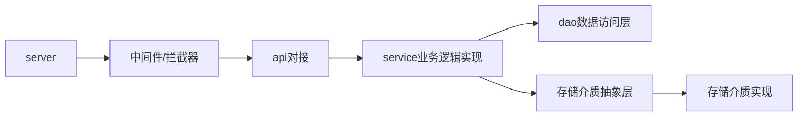
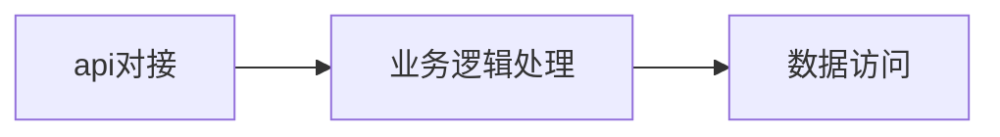
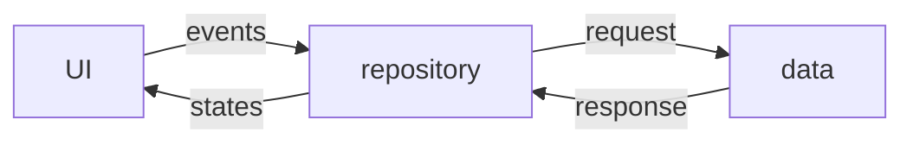

# 简介
这是一个文件管理系统，前后端分离，后端服务使用 golang 构建，前端使用 flutter 构建。

## 设计理念
本项目在设计时，有别于传统的网盘（dropbox，百度网盘等）或自建网盘（nextcloud，cloudreve等），或聚合网盘（openlist，rclone等）。

自建网盘虽然自身维护文件元数据，但是存储介质比较单一，主要是对象存储，不支持挂载网盘和 telegram 等多源存储；
传统网盘自定义度不高； 而聚合网盘不支持文件元数据的维护。

所以，本项目的目标是：

- 支持多存储介质，支持挂载网盘和 telegram 等多源存储
- 支持文件元数据的维护，不依赖存储介质
- 多副本高可用，支持存储介质无感切换


架构可以简单理解如下


# 数据及接口定义
为了方便数据复用，数据结构及接口全部采用 proto 定义。所以在尝试定义新的前后端交互需要用到的数据结构或接口前，应该先确认是否已在 [proto](proto/) 文件夹中定义了；如果没有，应该优先考虑新定义在 [proto](proto/) 中，以便前后端复用。

# 开发环境
- golang 环境已经搭建并配置好了，可以直接使用 go 命令
- flutter 开发环境使用了 puro 做版本管理，所以运行时，需要使用 puro flutter 和 puro dart 命令
- protobuf 编译环境也已配置好，可以直接使用 buf 命令
  ```
  // 编译成go语言
  buf generate
  // 编译成dart语言
  buf generate --template=buf.gen.dart.yaml
  ```
- 系统安装了git，并带了bash命令，可以执行bash命令切换到 MINGW64 环境

# 目录结构
- [frontend](./frontend/) 此目录存放前端文件
- [proto](./proto) 此目录存放 protobuf 数据结构和服务接口定义
- 除上面两个目录，剩余的是后端文件

# 项目架构
## 后端



### server
server 是整个应用的入口，负责启动服务和配置中间件。使用了 connectrpc 库，支持 grpc ，http 和 connect 三种协议；同时为了兼容 REST HTTP ，使用 connectrpc.com/vanguard 库进行协议转换。

使用 HTTP 发起请求时，有两种路径格式，下面以 [file.proto](./proto/file.proto)中的 GetFileList 接口为例。

- native.FileService/GetFileList

    即 包名.服务名/方法名，这种格式是 connectrpc 库默认的格式，可以直接使用。
- /api/file/list
    这种是 REST 请求的格式，使用这种格式需要在 proto 中添加 option (google.api.http) 扩展，所以如果接口没有添加这个扩展，则无法使用这种格式。

另外需要注意的是，使用 HTTP 请求时，数据格式是 json ，后端已经封装好，可以参考已有的实现。前端需要使用 toProto3Json 方法与后端保持一致，不能使用toJson或fromJson，会报错。

### 业务逻辑实现
api 请求的处理逻辑，可以简单分为三步走，即


业务逻辑处理涵盖面比较广，可以对接其它层，比如数据层，存储抽象层等。

### 数据访问层
数据访问层比较简单，主要就是访问数据库。

### 存储抽象层

存储抽象层，主要就是提供存储介质的抽象，将对存储介质的访问，抽象为接口，隐藏存储介质的实现细节。

### 存储介质实现
存储介质实现，主要就是实现存储介质的具体实现，比如本地存储，对象存储，telegram 存储等。

本项目还引入了 “组”（group）的概念。组是一个存储介质的集合；一个组可以包含一个或多个存储介质；一个组可以理解为一个虚拟磁盘。

引入组除了系统方便对接外，还能将系统对存储介质的管理与业务解耦。系统只需要与组进行交互，而对存储介质的管理则有组来处理。

## 前端
前端使用 flutter 构建，优先适配移动端。

### 路由
路由使用go_router 库实现，并使用Type-Safe Routes 来实现类型安全。新增路由时，也必须使用Type-Safe Routes 来实现类型安全。

### 状态管理
状态管理使用 flutter_bloc 库实现。采用标准的Bloc结构。

Repository由FmRepository实现，负责对接后端api获取数据。


### 页面布局

1. 登录页
对接casdoor进行登录认证，通过 webview_flutter 插件展示 casdoor 提供的登录页面。

2. 登录后内容页布局
分为上下两部分
- 上面是内容区域，根据下方的 bottombar 菜单选项切换不同页面
- 下面是 bottombar 菜单，使用 go_router 的 StatefulShellRoute 实现，切换页面可以保存之前页面的状态

3. bottombar 
bottombar有四个菜单项，分别是 首页、文件、传输、设置。

4. 首页菜单项
点击后，展示一个简单的欢迎页面。

5. 文件菜单项
点击后，跳转到文件列表页面。
- 页面布局，自上而下
  - appbar：左侧展示当前目录名称，右侧为“搜索”图标按钮和popupmenu菜单
    
    搜索功能：点击搜索按钮，展示输入框，完成后，执行搜索请求，并展示搜索结果页面
    
    popupmenu菜单：点击后弹出菜单，包括
    
    - 列表视图：点击后切换列表视图
    - 网格视图：点击后切换网格视图
    - 分割线
    - 名称：点击后按名称排序
    - 大小：点击后按大小排序
    - 类型：点击后按类型排序
    - 修改时间：点击后按修改时间排序
    - 创建时间：点击后按创建时间排序
   
  - 面包屑导航：展示当前文件路径，从左至右，点击可返回对应文件夹；行最右侧展示当前列表文件数

  - 文件列表：从左至右，图标、名称、大小、修改时间、操作按钮
    长按行，切换到多选模式
    
    操作按钮：点击后弹出操作菜单
    - 查看详情：点击后跳转详情页
    - 下载：点击后下载文件
    - 重命名：点击后弹出输入框，输入文件名称，完成后执行重命名文件
    - 复制链接：点击后复制文件链接
    - 移动：点击后弹出文件夹选择modal页面，选择确认后执行移动操作
    - 删除：点击后删除文件
  - 左下角悬浮按钮
    点击后弹出操作菜单
    - 刷新：点击后刷新文件列表
    - 新建文件夹：点击后弹出文件夹配置页，配置项参考[file.proto](./proto/file.proto)中的CreateDirReq


    - 上传文件：点击后跳转文件选择页面，选择确认后执行上传操作
    - 拍照上传：点击后打开相机，拍摄照片并上传
  6. 设置页
  设置页是一个设置项列表，每个设置项对应一个页面。
  - 主题设置: 点击后跳转主题设置页，包含主题模式设置和主题颜色设置，主题颜色使用flex_scheme_color自带的颜色主题
  - 语言设置
  - 存储组设置: 根据proto里面storage group数据结构及接口定义设置form表
  - 存储介质设置：根据proto里面stroage provider数据结构及接口定义设置form表
  - 退出登录：点击后，清空登录信息，跳转到登录页面
  7. 传输菜单项
  点击后，打开传输页面。这是一个tab页，包含上传，下载两个tab页
  


## 代码生成要求
- 代码要有必要的注释
- 在出现异常或错误时，必须添加必要的日志记录
- UI设计简洁美观，现代化，符合Material3设计规范
- 前端各页面，组件风格要保持一致，且能够响应主题切换
- 前端form表单统一使用flutter_form_builder和form_builder_validators


  


